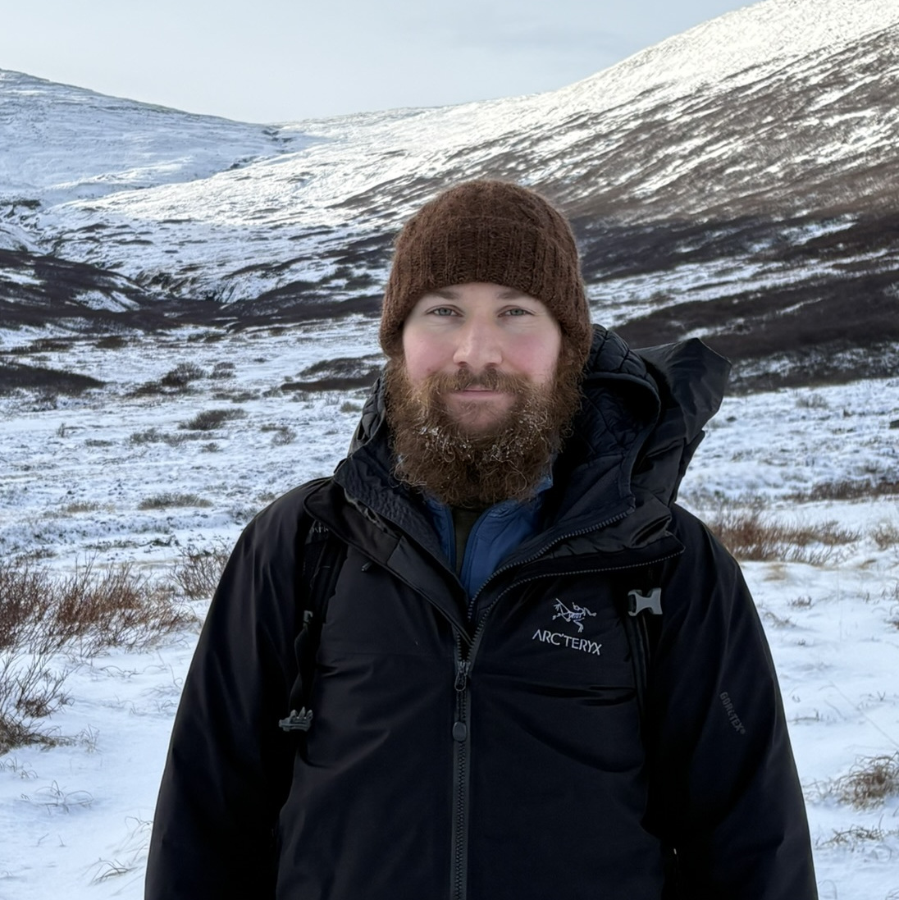

## Bio
{: width="300" style="float:right; padding-left:10px"}

I am a Postdoctoral Researcher at the [Institute for Quantum Computing](https://uwaterloo.ca/institute-for-quantum-computing/){:target="_blank"} and the [Applied Mathematics Department](https://uwaterloo.ca/applied-mathematics/){:target="_blank"} at University of Waterloo. I work on the foundations and mathematics of quantum information and quantum computation. In particular, I study classical simulation algorithms for quantum computation, the relation between classical and quantum coding theory, and the role of indicators of non-classical physics like quantum contextuality and negativity in quasiprobability representations in providing the computational speedup of quantum computation over classical computation.

Resume: [pdf](/files/resume.pdf){:target="_blank"}. 
Academic CV: [pdf](/files/cv.pdf){:target="_blank"}. 

## Background
- Born in St. John's, Newfoundland in June, 1996
- Graduated from Gonzaga High School in June, 2014
- Graduated with a BSc from University of British Columbia in May, 2019
  - Bachelor of Science - Combined Honours in Physics and Mathematics with Distinction
  - Honours thesis: *Contextuality and Simulating Quantum Computation with Magic States* supervised by Dr. Robert Raussendorf
- Graduated with a MSc in Physics from University of British Columbia in October, 2020
  - Supervised by Dr. Robert Raussendorf
  - Masters thesis: *Hidden Variable Models and Classical Simulation Algorithms for Quantum Computation with Magic States on Qubits* [[pdf]](/files/papers/ubc_2020_november_zurel_michael.pdf){:target="_blank"}
- Graduated with a PhD in Physics from University of British Columbia in August, 2024
  - Supervised by [Dr.&nbsp;Robert Raussendorf](https://g.co/kgs/h9wh4n){:target="_blank"} and [Dr.&nbsp;William G. Unruh](https://g.co/kgs/P5QevA){:target="_blank"}
  - PhD Thesis: *Classical descriptions of quantum computations : foundations of quantum computation via hidden variable models, quasiprobability representations, and classical simulation algorithms* [[pdf]](/files/papers/ubc_2024_november_zurel_michael.pdf){:target="_blank"}
- NSERC postdoc in the Department of Mathematics at Simon Fraser University from 2024 to 2026, working with [Dr.&nbsp;Nadish de Silva](http://www.sfu.ca/~ndesilva/){:target="_blank"}, Canada Research Chair in the Mathematics of Quantum Computation
- Currently a postdoc at the Institute for Quantum Computing at University of Waterloo

## Collaborators
Some of my recent collaborators include
- [Robert Raussendorf](https://g.co/kgs/h9wh4n){:target="_blank"}
- [Shiroman Prakash](https://www.dei.ac.in/dei/science/index.php/phy-faculty/90-physicsfaculty/185-dr-shiroman-prakash){:target="_blank"}
- [Jack Davis](https://scholar.google.com/citations?hl=en&user=-jqXMB8AAAAJ){:target="_blank"}
- [Nadish de Silva](https://www.sfu.ca/~ndesilva/){:target="_blank"}
- [Larry Cohen](https://www.linkedin.com/in/lawrence-cohen-00950a231/){:target="_blank"}
- [Polina Feldmann](https://www.researchgate.net/scientific-contributions/Polina-Feldmann-2165463528){:target="_blank"}
- [Arne Heimendahl](https://www.mi.uni-koeln.de/opt/arne-heimendahl/){:target="_blank"}
- [Juani Bermejo-Vega](https://scholar.google.com/citations?user=bcI03DIAAAAJ&hl=en&inst=17001591832933267808&oi=ao){:target="_blank"}
- [Emily Tyhurst](https://www.physics.utoronto.ca/~etyhurst/){:target="_blank"}
- [Cihan Okay](https://www.cihanokay.com/){:target="_blank"}
- [Santanil Jana](https://sjana01.github.io/){:target="_blank"}